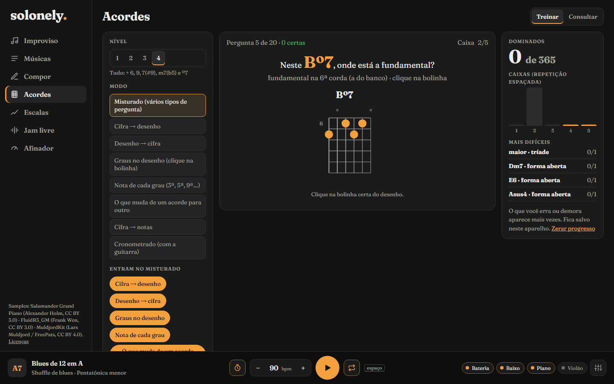
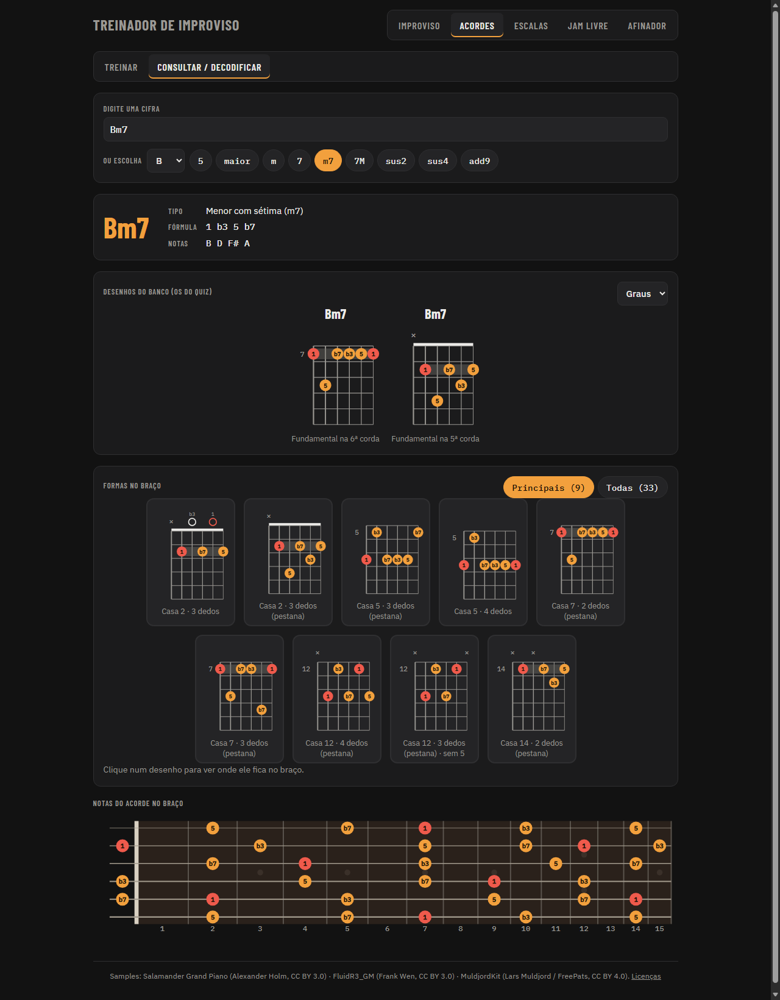
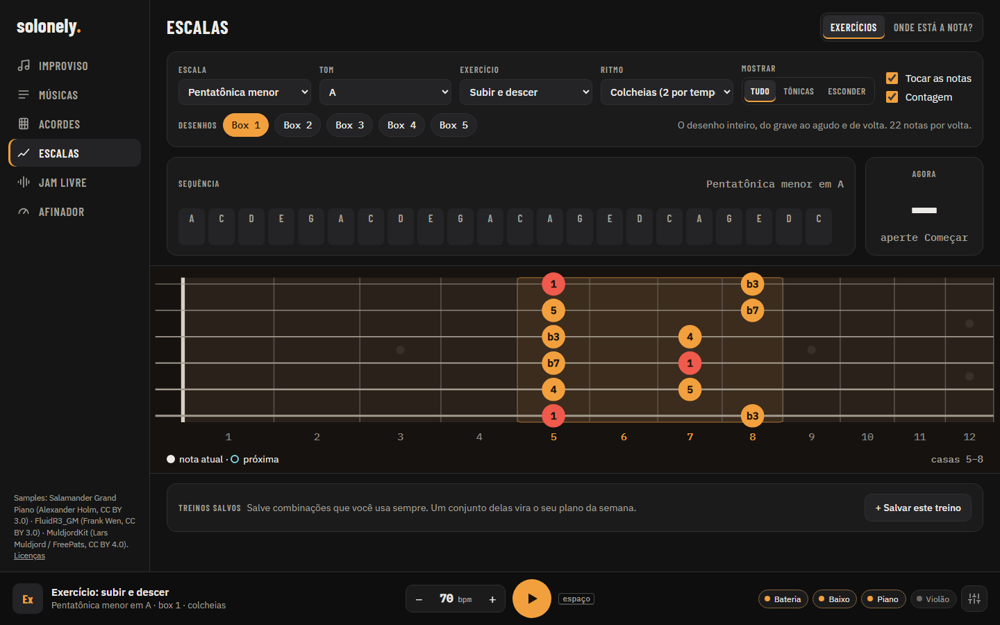
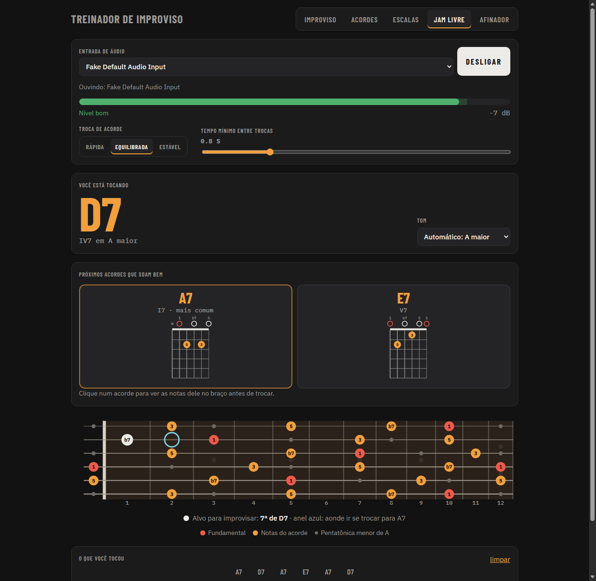
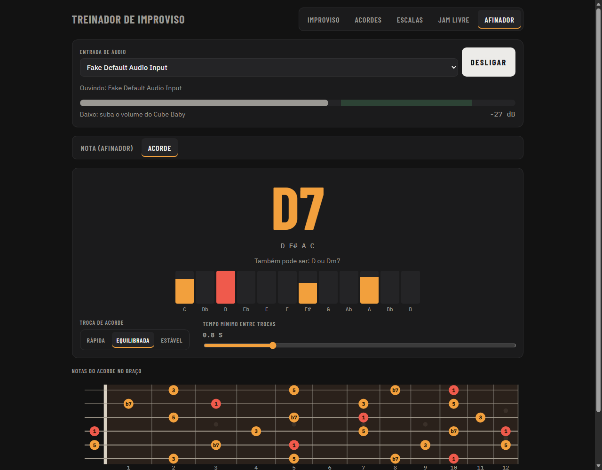
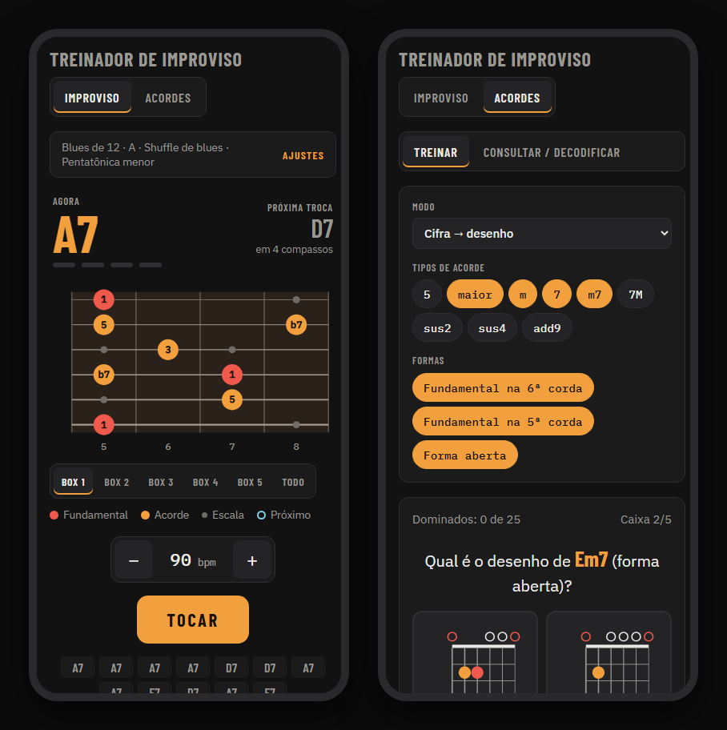
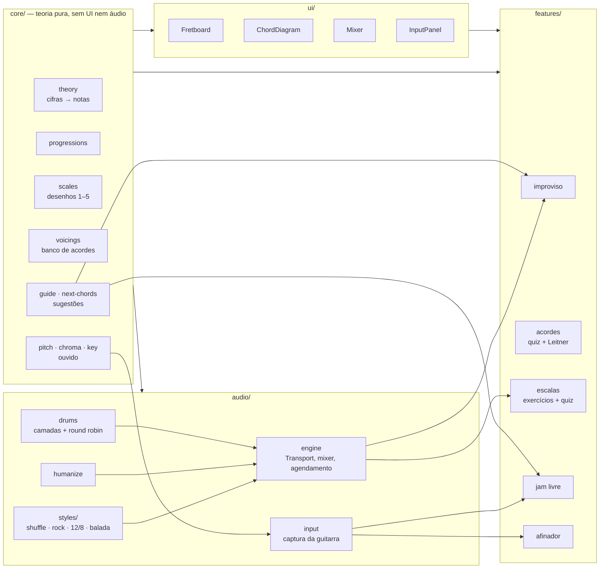

# Treinador de Improviso

[](https://github.com/depaula12/treinador-improviso/actions/workflows/ci.yml)


### ▶ [Teste agora: treinador-improviso.vercel.app](https://treinador-improviso.vercel.app)

**Uma banda de apoio no navegador para guitarristas praticarem improviso, acordes e escalas.**
A base toca com bateria, baixo, piano e violão de verdade (samples), e o braço da guitarra mostra,
compasso a compasso, para onde mirar: a escala, as notas do acorde da vez e a próxima troca.
Com a guitarra ligada (interface USB ou microfone), o app **ouve o que você toca**: afina, reconhece
notas e acordes e, na Jam livre, sugere os próximos acordes e as notas-alvo em tempo real.


> **In English:** a browser-based backing band and practice tool for guitarists. It plays
> humanized, sample-based backing tracks (drums, bass, piano, acoustic guitar) and shows target
> notes on an interactive fretboard in real time. It also listens to your guitar (USB interface or mic):
> pitch and chord detection, key estimation and live next-chord suggestions. Built with React,
> TypeScript and Tone.js; runs entirely in the browser, no backend.

---

## O problema

Quem está aprendendo a improvisar costuma ficar preso em "tocar a pentatônica inteira, aleatória"
por cima de uma base genérica do YouTube. Faltam três coisas:

1. **Uma base que soe como banda** e não como metrônomo, no tom, andamento e estilo que você quiser.
2. **Saber para onde mirar** em cada acorde, e não só que escala usar.
3. **Treino deliberado** dos acordes e desenhos que você ainda erra.
4. **Retorno sobre o que você tocou**, e não só sobre o que deveria tocar.

## O que o app faz

### Improviso
- Progressões prontas (blues de 12 normal e *quick change*, I–V–vi–IV, I–bVII–IV, i–bVII–bVI)
  ou digitadas (`Am*2 G F E7`).
- Quatro estilos: **shuffle de blues**, **rock reto**, **slow blues 12/8** e **pop rock/balada**.
- O braço mostra o desenho (box 1–5) em foco: a **fundamental** em vermelho, as **notas do acorde**
  em destaque com o grau (3, b7…) e a escala em pontos discretos. No tempo 4, brilham as notas do
  **próximo acorde**.
- **Alvos sugeridos (notas-guia)**: a cada compasso, uma bolinha branca marca a 3ª ou a 7ª do acorde,
  sempre a mais próxima do alvo anterior, formando uma linha suave (ex.: a 3ª de A7 desce meio tom
  até a b7 de D7). Improvise livre e pouse no alvo no tempo 1.
- Restrições sorteáveis para treino deliberado: "só box 2", "termine frases na 3ª",
  "só cordas 1 e 2"…
- Mixer (bateria, baixo, piano, violão), contagem de entrada, loop, virada a cada 4 ou 8 compassos.

### Acordes



- Banco com ~30 formas móveis e abertas (power, maior, menor, 7, m7, 7M, sus2, sus4, add9),
  com fundamental na 6ª e na 5ª corda.
- **Consulta**: digite qualquer cifra (inclusive Am7b5, E9, C13, D/F#) e veja fórmula, notas e
  **todas as formas tocáveis no braço**, geradas por busca (até 4 dedos, contando pestana) e
  ordenadas da casa 1 à 15. As principais aparecem primeiro; clicar num desenho mostra onde
  ele fica no braço.


- **Quatro quizzes**: cifra → desenho, desenho → cifra, cifra → notas e um modo **cronometrado**
  para fazer com a guitarra na mão.
- **Repetição espaçada (Leitner)**: o que você erra ou demora aparece mais vezes.

### Escalas



- Pentatônica menor e maior, blues, maior e menor natural, nos **desenhos 1–5**, em qualquer tom.
- Exercícios no metrônomo, com a nota da vez acesa no braço (e a próxima marcada): **subir e descer**,
  **grupos de 3 e de 4**, **terças** e **percorrer os boxes** (sobe um, desce o seguinte, atravessando o braço).
- Ritmo em semínimas, colcheias, tercinas ou semicolcheias; opção de ouvir cada nota no violão.
- Exibição para memorizar: tudo, **só as tônicas** ou **esconder e revelar**.
- **Onde está a nota?**: quiz clicando no braço ("onde está o Lá na 3ª corda?"), com repetição espaçada.
- **Treinos salvos**: combinações favoritas viram o plano da semana.

### Jam livre



Você toca livre; o app escuta e acompanha:
- **acorde que você está tocando** e a função dele no tom ("IV7 em Lá maior");
- **tom estimado** a partir do que foi tocado; quando é ambíguo (ex.: Em–D–C–D), mostra o rival para você fixar;
- **3 próximos acordes** que soam bem, com o desenho de cada um (clique para ver as notas no braço antes de trocar);
- **alvo para improvisar** (3ª/7ª do acorde) perto da última nota que você tocou, e o anel de aonde ir se trocar;
- histórico do que você tocou.

### Afinador e leitura de acordes



- **Afinador** com ponteiro em cents e a nota acesa em todas as posições do braço.
- **Modo acorde**: o acorde soando, palpites alternativos e a energia de cada uma das 12 notas.
- **Troca de acorde configurável**: rápida, equilibrada ou estável, e tempo mínimo entre trocas.
- Medidor de nível com a faixa ideal, e a interface USB (ex.: Cube Baby) escolhida sozinha.

### No celular

<p align="center"></p>

## Destaques técnicos

**Motor de áudio que não soa robótico.** O protótipo original usava osciladores e soava como
um teclado de brinquedo. O motor novo foi escrito do zero sobre o Tone.js:

| Técnica | Como |
|---|---|
| Samples reais | Bateria multisample com camadas de intensidade e *round robin* (alterna gravações do mesmo golpe), piano Salamander, baixo e violão de soundfont |
| Swing de verdade | Colcheias tercinadas (2/3 do tempo) no shuffle e no 12/8, não um "atraso" aproximado |
| Humanização | Desvio de tempo por instrumento (o baixo toca levemente atrás), variação de intensidade, *ghost notes* na caixa |
| Arranjo | Variações A/B por frase, viradas, prato na entrada da frase, baixo idiomático por estilo (desenho de shuffle, aproximação cromática antes da troca) |
| Piano | **Voice leading**: escolhe a inversão com menor movimento em relação ao acorde anterior |
| Violão | *Strum* real, com 10–25 ms entre as cordas e batida para cima e para baixo |

**Agendamento preciso e Parar instantâneo.** Cada nota vira um evento do `Tone.Transport` e só é
entregue ao Web Audio ~50 ms antes de soar. O Parar descarta a fila e fecha um *gate* em 30 ms.
Um detalhe que exigiu ler o código do Tone.js: eventos agendados para o mesmo *tick* que está sendo
processado são ignorados, então cada compasso é montado uma semicolcheia antes de começar.

**A tela acompanha o som.** As atualizações visuais compensam a latência de saída do áudio
(`outputLatency`), que em fone Bluetooth passa de 200 ms.

**Teoria musical testada.** Cifras são interpretadas com `tonal`, incluindo a notação brasileira (7M).
Os 249 desenhos de acorde (9 tipos × 12 tons × formas) são verificados automaticamente: notas certas,
fundamental no baixo, casas válidas e abertura tocável.

**Desempenho.** Assinaturas seletivas no estado (Zustand) e SVG memoizado: a cada batida só os
indicadores de tempo re-renderizam; o braço só redesenha na troca de acorde.

**Ouvido de guitarra, sem servidor e sem IA pesada.** Tudo roda no navegador, em tempo real:

| Etapa | Como |
|---|---|
| Nota | Método de McLeod (`pitchy`) limitado à faixa da guitarra, com **histerese**: clareza 0,9 para começar uma nota e 0,6 para mantê-la enquanto a corda perde força; mediana contra saltos de oitava |
| Acorde | Espectro de 16 384 pontos → energia das 12 notas (picos com interpolação e **compressão**) → comparação com os moldes de 9 tipos × 12 fundamentais; power chord só sem 3ª |
| Estabilidade | O acorde atual só é trocado por um claramente mais provável, depois de um tempo mínimo configurável; média móvel do espectro |
| Tom | Perfis de **Krumhansl-Kessler** sobre os acordes tocados, com dica de tônica (o acorde que abre e o que mais repousa) |
| Sugestões | Tabelas de transição de blues (I7–IV7–V7), tons maiores e menores, por grau no tom |

Os parâmetros da leitura de acordes saíram de uma **busca sistemática** em 280 acordes sintéticos com
volume aleatório por corda: a primeira versão acertava 43%; a final acerta 113 de 113 desenhos do banco
e foi validada com guitarra real.

**Teste ponta a ponta no navegador** (`npm run e2e`, em [`scripts/e2e-jam.mjs`](scripts/e2e-jam.mjs)).
Um áudio de guitarra gerado (A7 → D7 → A7 → E7) é entregue ao Chrome/Edge headless como se fosse o
microfone; via DevTools Protocol o script liga a entrada e confere que a Jam reconhece a sequência,
estima Lá maior e sugere acordes do blues. Os prints da Jam e do Afinador acima saíram desse processo.

## Arquitetura



O princípio é que **as áreas compartilham o núcleo**: a mesma teoria alimenta a base, o braço e os
quizzes. Uma música importada (próxima fase) vai servir ao mesmo tempo de base de improviso, de filtro
do quiz de acordes e de cifra rolando no tempo.

## Stack

| | |
|---|---|
| Interface | React 19, TypeScript (strict), Vite |
| Áudio | Tone.js (Transport, Sampler, efeitos) |
| Teoria musical | tonal |
| Detecção de nota | pitchy (McLeod) + Web Audio `AnalyserNode` |
| Estado | Zustand (com persistência local) |
| Testes | Vitest (374 testes) + GitHub Actions |
| Dados | Tudo local no navegador; sem backend |
| Deploy | Vercel (publica a cada push em `main`) |

## Rodar localmente

```bash
npm install
npm run dev        # desenvolvimento
npm test           # testes
npm run build      # versão final (depois: npm run preview)
npm run e2e        # com o preview rodando: Jam livre num navegador headless com microfone simulado
```

> No PowerShell do Windows, se o `npm` acusar "execução de scripts desabilitada", use `npm.cmd`
> ou rode uma vez `Set-ExecutionPolicy -Scope CurrentUser RemoteSigned`.

## Roadmap

- [x] Motor de áudio com 4 estilos, mixer e humanização
- [x] Improviso: braço com foco por desenho, próxima troca, alvos sugeridos, restrições, progressão digitada
- [x] Acordes: banco, decodificador, quizzes e repetição espaçada
- [x] **Escalas**: desenhos 1–5, exercícios no metrônomo, quiz "onde está a nota" e treinos salvos
- [x] **Entrada de áudio** (interface USB ou microfone): afinador, detecção de nota e de acorde
- [x] **Jam livre** (primeira versão): acorde e tom detectados, próximos acordes e notas-alvo em tempo real
- [ ] **Músicas**: colar uma cifra e virar base de treino, com grade de compassos editável
- [ ] **Treino do dia + progresso**: sessão montada automaticamente e histórico de acertos
- [ ] Jam livre aprendendo as transições com as músicas do seu repertório
- [ ] Quiz cronometrado conferido pelo áudio (o app ouve se você tocou o acorde pedido)

O planejamento detalhado e as decisões de projeto estão em [`CLAUDE.md`](CLAUDE.md), e o plano
das próximas versões em [`docs/plano.md`](docs/plano.md).

## Créditos

Samples gratuitos com licença Creative Commons, detalhados em
[`public/samples/LICENSES.md`](public/samples/LICENSES.md):
Salamander Grand Piano (Alexander Holm, CC BY 3.0), FluidR3_GM (Frank Wen, CC BY 3.0) e
MuldjordKit (Lars Muldjord, CC BY 4.0).
