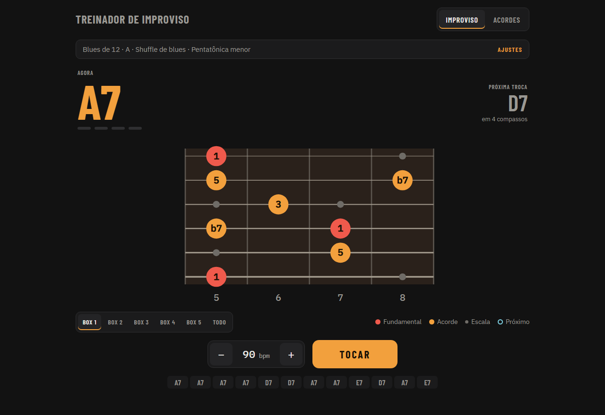
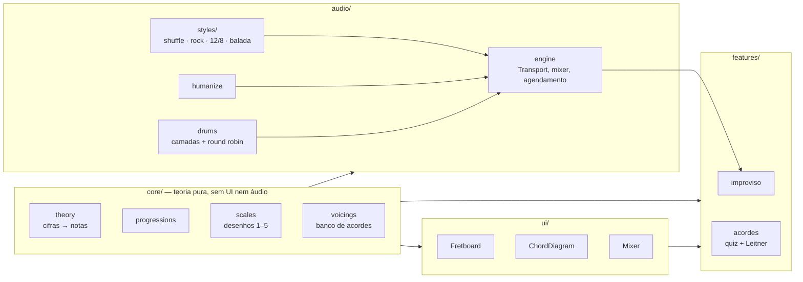

# Treinador de Improviso

[](https://github.com/depaula12/treinador-improviso/actions/workflows/ci.yml)


**Uma banda de apoio no navegador para guitarristas praticarem improviso, acordes e escalas.**
A base toca com bateria, baixo, piano e violão de verdade (samples), e o braço da guitarra mostra,
compasso a compasso, para onde mirar: a escala, as notas do acorde da vez e a próxima troca.



> **In English:** a browser-based backing band and practice tool for guitarists. It plays
> humanized, sample-based backing tracks (drums, bass, piano, acoustic guitar) and shows target
> notes on an interactive fretboard in real time. Built with React, TypeScript and Tone.js; runs entirely
> in the browser, no backend.

---

## O problema

Quem está aprendendo a improvisar costuma ficar preso em "tocar a pentatônica inteira, aleatória"
por cima de uma base genérica do YouTube. Faltam três coisas:

1. **Uma base que soe como banda** e não como metrônomo, no tom, andamento e estilo que você quiser.
2. **Saber para onde mirar** em cada acorde, e não só que escala usar.
3. **Treino deliberado** dos acordes e desenhos que você ainda erra.

## O que o app faz

### Improviso
- Progressões prontas (blues de 12 normal e *quick change*, I–V–vi–IV, I–bVII–IV, i–bVII–bVI)
  ou digitadas (`Am*2 G F E7`).
- Quatro estilos: **shuffle de blues**, **rock reto**, **slow blues 12/8** e **pop rock/balada**.
- O braço mostra o desenho (box 1–5) em foco: a **fundamental** em vermelho, as **notas do acorde**
  em destaque com o grau (3, b7…) e a escala em pontos discretos. No tempo 4, brilham as notas do
  **próximo acorde**.
- Restrições sorteáveis para treino deliberado: "só box 2", "termine frases na 3ª",
  "só cordas 1 e 2"…
- Mixer (bateria, baixo, piano, violão), contagem de entrada, loop, virada a cada 4 ou 8 compassos.

### Acordes


- Banco com ~30 formas móveis e abertas (power, maior, menor, 7, m7, 7M, sus2, sus4, add9),
  com fundamental na 6ª e na 5ª corda.
- **Decodificador**: digite qualquer cifra e veja fórmula, notas, desenhos e o acorde no braço.
- **Quatro quizzes**: cifra → desenho, desenho → cifra, cifra → notas e um modo **cronometrado**
  para fazer com a guitarra na mão.
- **Repetição espaçada (Leitner)**: o que você erra ou demora aparece mais vezes.

### No celular

<p align="center"></p>

## Destaques técnicos

**Motor de áudio que não soa robótico.** O protótipo original usava osciladores e soava como
um teclado de brinquedo. O motor novo foi escrito do zero sobre o Tone.js:

| Técnica | Como |
|---|---|
| Samples reais | Bateria multisample com camadas de intensidade e *round robin* (alterna gravações do mesmo golpe), piano Salamander, baixo e violão de soundfont |
| Swing de verdade | Colcheias tercinadas (2/3 do tempo) no shuffle e no 12/8, não um "atraso" aproximado |
| Humanização | Desvio de tempo por instrumento (o baixo toca levemente atrás), variação de intensidade, *ghost notes* na caixa |
| Arranjo | Variações A/B por frase, viradas, prato na entrada da frase, baixo idiomático por estilo (desenho de shuffle, aproximação cromática antes da troca) |
| Piano | **Voice leading**: escolhe a inversão com menor movimento em relação ao acorde anterior |
| Violão | *Strum* real, com 10–25 ms entre as cordas e batida para cima e para baixo |

**Agendamento preciso e Parar instantâneo.** Cada nota vira um evento do `Tone.Transport` e só é
entregue ao Web Audio ~50 ms antes de soar. O Parar descarta a fila e fecha um *gate* em 30 ms.
Um detalhe que exigiu ler o código do Tone.js: eventos agendados para o mesmo *tick* que está sendo
processado são ignorados, então cada compasso é montado uma semicolcheia antes de começar.

**A tela acompanha o som.** As atualizações visuais compensam a latência de saída do áudio
(`outputLatency`), que em fone Bluetooth passa de 200 ms.

**Teoria musical testada.** Cifras são interpretadas com `tonal`, incluindo a notação brasileira (7M).
Os 249 desenhos de acorde (9 tipos × 12 tons × formas) são verificados automaticamente: notas certas,
fundamental no baixo, casas válidas e abertura tocável.

**Desempenho.** Assinaturas seletivas no estado (Zustand) e SVG memoizado: a cada batida só os
indicadores de tempo re-renderizam; o braço só redesenha na troca de acorde.

## Arquitetura



O princípio é que **as áreas compartilham o núcleo**: a mesma teoria alimenta a base, o braço e os
quizzes. Uma música importada (próxima fase) vai servir ao mesmo tempo de base de improviso, de filtro
do quiz de acordes e de cifra rolando no tempo.

## Stack

| | |
|---|---|
| Interface | React 19, TypeScript (strict), Vite |
| Áudio | Tone.js (Transport, Sampler, efeitos) |
| Teoria musical | tonal |
| Estado | Zustand (com persistência local) |
| Testes | Vitest (297 testes) + GitHub Actions |
| Dados | Tudo local no navegador; sem backend |

## Rodar localmente

```bash
npm install
npm run dev        # desenvolvimento
npm test           # testes
npm run build      # versão final (depois: npm run preview)
```

> No PowerShell do Windows, se o `npm` acusar "execução de scripts desabilitada", use `npm.cmd`
> ou rode uma vez `Set-ExecutionPolicy -Scope CurrentUser RemoteSigned`.

## Roadmap

- [x] Motor de áudio com 4 estilos, mixer e humanização
- [x] Improviso: braço com foco por desenho, próxima troca, restrições, progressão digitada
- [x] Acordes: banco, decodificador, quizzes e repetição espaçada
- [ ] **Escalas**: montador de treino (desenhos, sequências, conexão entre boxes) e predefinições
- [ ] **Músicas**: colar uma cifra e virar base de treino, com grade de compassos editável
- [ ] **Treino do dia + progresso**: sessão montada automaticamente e histórico de acertos
- [ ] **Entrada de áudio** (guitarra via interface USB): afinador, detecção de nota, validação do quiz
- [ ] **Jam livre**: detecta o que você toca e sugere próximos acordes e notas-alvo em tempo real
      (cadeia de Markov sobre progressões de blues/rock e do seu repertório)

O planejamento detalhado e as decisões de projeto estão em [`CLAUDE.md`](CLAUDE.md).

## Créditos

Samples gratuitos com licença Creative Commons, detalhados em
[`public/samples/LICENSES.md`](public/samples/LICENSES.md):
Salamander Grand Piano (Alexander Holm, CC BY 3.0), FluidR3_GM (Frank Wen, CC BY 3.0) e
MuldjordKit (Lars Muldjord, CC BY 4.0).
